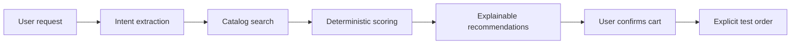

# PayPilot AI

PayPilot is a local-first AI shopping pilot. Describe what you need in natural language and it extracts intent, searches the seeded catalog, ranks the best matches, explains the result, stages a cart, and records an explicit test-mode order.

## Run locally

```powershell
python -m pip install -r requirements.txt
uvicorn backend.main:app --reload
```

Open `frontend/index.html` in a browser. The API runs at `http://127.0.0.1:8000` and uses the seeded CSV catalog plus a local SQLite database at `database/paypilot.db`.

## Agent pipeline



The fallback engine works without an LLM key. Scores are based on category, budget, requested features, rating, availability, and use case. Raw chain-of-thought is never returned to the client. A checkout request is rejected until customer details exist and the user presses the confirmation action.

## API

`POST /agent` searches and ranks products. The requested JSON routes are also available at `POST /api/agent`, `GET /api/products`, `GET /api/products/{id}`, `POST /api/products/compare`, `POST /api/payment/create-order`, and `POST /api/payment/verify`. Cart operations are available at `GET /cart`, `POST /cart/add`, `PUT /cart/update`, `DELETE /cart/remove/{product_name}`, and `DELETE /cart/clear`. Checkout uses `GET /checkout` for a preview and `POST /checkout` to persist an explicitly confirmed local test order. Orders are available at `GET /orders` and `GET /orders/{order_id}`.

## Demo prompts

- Wireless headphones under ₹5,000 with good battery
- Laptop under ₹80,000 for coding and AI
- Smartphone under ₹40,000 with a good camera

Razorpay credentials are intentionally not required by the local demo. The payment routes return a safe local test result until a Razorpay adapter is configured. When connecting Razorpay, keep `RAZORPAY_KEY_SECRET` server-side and use only test credentials.
